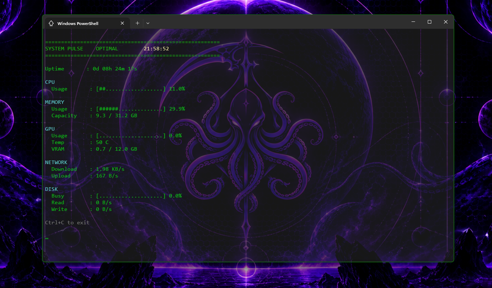

# SystemPulse, 


A lightweight real-time Windows system monitor built in PowerShell because Task Manager refuses to be transparent.


SystemPulse was created as a minimal, low-overhead telemetry dashboard that can live inside a transparent PowerShell or Windows Terminal window. The original goal was simple:


> Keep an eye on system health while gaming, working or multitasking on a single-screen setup without dedicating screen space to Task Manager or other monitoring applications.


---


## Screenshot





---


## Features


- Live CPU utilisation monitoring

- Live memory utilisation monitoring

- NVIDIA GPU utilisation monitoring

- NVIDIA GPU temperature monitoring

- VRAM usage monitoring

- Live network download/upload throughput

- Disk activity monitoring

- System uptime tracking

- Dynamic system health status

- Dynamic HUD border colouring

- Lightweight PowerShell implementation

- Transparent terminal friendly


---


## Status Levels


SystemPulse automatically evaluates the highest current system load and displays an overall status:


| Status | Meaning |

|----------|----------|

| OPTIMAL | Load below 60% |

| ELEVATED LOAD | Load between 60% and 84% |

| STRESSED | Load between 85% and 94% |

| CRITICAL | Load above 95% |


The dashboard border changes colour to match the current system state.


- Green = OPTIMAL

- Yellow = ELEVATED LOAD

- Red = STRESSED / CRITICAL


---


\## Requirements


- Windows

- Windows PowerShell 5.1 or newer

- NVIDIA drivers installed (for optional GPU telemetry)


If no NVIDIA GPU is detected, SystemPulse will continue running and simply disable GPU telemetry.


---


## Installation


Download or clone the repository to any folder.


Example:


```powershell

git clone https://github.com/octaphel/SystemPulse.git

```


or simply download and extract the ZIP archive.


---


## Usage


Open a PowerShell window inside the SystemPulse folder and run:


```powershell

.\\SystemPulse.ps1

```


The dashboard will refresh automatically once per second.


Exit at any time with:


```text

Ctrl+C

```


---


## Recommended Setup


SystemPulse works especially well when paired with:


- Windows Terminal

- PowerShell

- Transparent background enabled

- Always-on-top terminal window


This allows the dashboard to act as a lightweight HUD while gaming, working or browsing on a single monitor.


---


## Project Philosophy


SystemPulse intentionally focuses on:


- Simplicity

- Readability

- Low overhead

- Minimal dependencies


It is not intended to replace HWiNFO, MSI Afterburner or similar full-featured monitoring suites.


Instead, it aims to provide the most useful system telemetry at a glance inside a terminal window.


---


## Current Metrics


### CPU


- Total CPU usage


### Memory


- Memory usage percentage

- Used memory

- Total memory


### GPU


- GPU utilisation

- GPU temperature

- VRAM usage


### Network


- Download throughput

- Upload throughput


### Storage


- Disk activity percentage

- Disk read throughput

- Disk write throughput


\### System


- Current time

- System uptime

- Overall status


---


##
