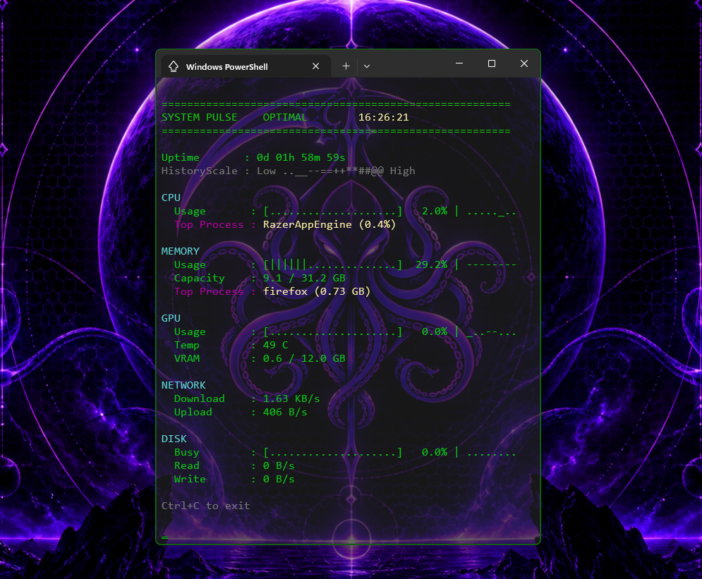

# SystemPulse

A lightweight real-time Windows system monitor built in PowerShell because Task Manager refuses to be transparent.

SystemPulse was created as a minimal, low-overhead telemetry dashboard designed to live inside a transparent PowerShell or Windows Terminal window.

The goal is simple:

> Keep an eye on system health while gaming, working, streaming or multitasking on a single-screen setup without sacrificing space to Task Manager or heavyweight monitoring suites.

---

## Screenshot



---

## Features

### Live Monitoring

- CPU utilisation monitoring
- Memory utilisation monitoring
- NVIDIA GPU utilisation monitoring
- NVIDIA GPU temperature monitoring
- VRAM usage monitoring
- Network download throughput
- Network upload throughput
- Disk activity monitoring
- System uptime tracking

### Resource Insight

- Top CPU-consuming process detection
- Top memory-consuming process detection

### History & Trends

- 8-second CPU history graph
- 8-second memory history graph
- 8-second GPU history graph
- 8-second disk activity history graph
- Built-in graph scale legend
- Rolling trend visualisation without leaving the dashboard

### Dashboard Features

- Dynamic system health evaluation
- Dynamic HUD border colouring
- Compact single-screen layout
- Real-time updates
- Transparent terminal friendly
- Lightweight PowerShell implementation
- No installation required

---

## Status Levels

SystemPulse continuously evaluates the highest current system load and assigns an overall system state.

| Status | Meaning |
|----------|----------|
| OPTIMAL | Load below 60% |
| ELEVATED LOAD | Load between 60% and 84% |
| STRESSED | Load between 85% and 94% |
| CRITICAL | Load above 95% |

The dashboard border changes colour automatically:

- Green = OPTIMAL
- Yellow = ELEVATED LOAD
- Red = STRESSED / CRITICAL

---

## History Graph Scale

SystemPulse includes compact rolling history graphs for quick trend recognition.

```text
Low ..__--==++**##@@ High
```

Higher symbols represent higher resource utilisation over the previous 8 seconds.

---

## Requirements

- Windows 10 / Windows 11
- Windows PowerShell 5.1 or newer
- NVIDIA drivers installed (optional GPU telemetry)

If no NVIDIA GPU is detected, SystemPulse will continue running and simply disable GPU-related telemetry.

---

## Installation

### Clone the repository

```bash
git clone https://github.com/octaphel/SystemPulse.git
```

### Or

Download the latest release ZIP and extract it to any folder.

---

## Usage

Open PowerShell inside the SystemPulse folder and run:

```powershell
.\SystemPulse.ps1
```

The dashboard refreshes automatically once per second.

Exit at any time using:

```text
Ctrl + C
```

---

## Recommended Setup

SystemPulse works especially well when paired with:

- Windows Terminal
- PowerShell
- Acrylic or transparent backgrounds
- Always-on-top terminal windows

This creates a lightweight telemetry HUD that remains visible while gaming, working or browsing.

---

## Current Metrics

### CPU

- Total CPU utilisation
- Top CPU-consuming process
- 8-second utilisation history

### Memory

- Memory utilisation percentage
- Used memory
- Total memory
- Top memory-consuming process
- 8-second utilisation history

### GPU

- GPU utilisation
- GPU temperature
- VRAM utilisation
- 8-second utilisation history

### Network

- Download throughput
- Upload throughput

### Storage

- Disk activity percentage
- Disk read throughput
- Disk write throughput
- 8-second activity history

### System

- System uptime
- Current time
- Overall health status

---

## Release Lineage

### Baseline

Initial public release establishing the core monitoring dashboard.

### Heartbeat

Introduced top-process monitoring for CPU and memory usage.

### Rhythm

Introduced compact rolling history graphs for CPU, memory, GPU and disk activity.

---

## Project Philosophy

SystemPulse intentionally focuses on:

- Simplicity
- Readability
- Low overhead
- Minimal dependencies
- Useful information at a glance

It is not intended to replace tools such as HWiNFO, MSI Afterburner, Process Explorer or Task Manager.

Instead, the goal is to surface the most useful performance information possible inside a clean terminal dashboard.

---

---

Built with PowerShell